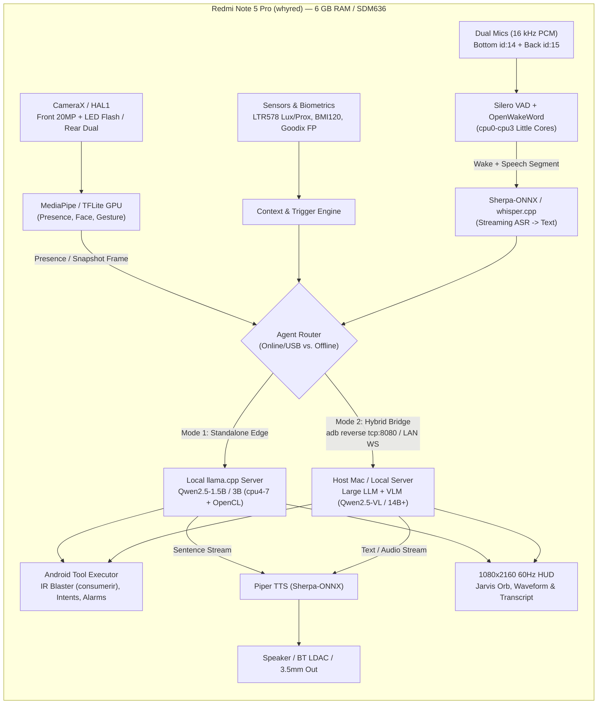

# Xiaomi Redmi Note 5 Pro (`whyred`) — ADB Hardware Audit & "Jarvis" Edge AI Feasibility Report

> **Audit Date:** 2026-11-16  
> **Connection:** USB ADB (`serial: <serial>`, `transport_id: 80`, `ro.boot.usb.controller: a800000.dwc3`)  
> **Target Device:** Xiaomi Redmi Note 5 Pro (`whyred` / `whyred_global`, India `MEI7S`, `6 GB RAM / 64 GB Storage`)  
> **Primary Objective:** Evaluate hardware capabilities via live USB ADB diagnostics to determine feasibility of running small on-device AI models (SLM, ASR, TTS, Vision) and turning the device into a multimodal **"Jarvis"** assistant using its **cameras, display, microphones, speaker, sensors, and IR blaster**.

---

## Table of Contents (Index)

- [1. Executive Summary & "Jarvis" Feasibility Verdict](#1-executive-summary--jarvis-feasibility-verdict)
  - [1.1 Quick-Glance Device Identity Card](#11-quick-glance-device-identity-card)
  - [1.2 Jarvis Subsystem Readiness Matrix](#12-jarvis-subsystem-readiness-matrix)
- [2. System Identity, OS, Firmware & Security Posture](#2-system-identity-os-firmware--security-posture)
  - [2.1 Device & Build Properties (`getprop`)](#21-device--build-properties-getprop)
  - [2.2 Security, Encryption & Bootloader Unlock Readiness](#22-security-encryption--bootloader-unlock-readiness)
- [3. SoC, CPU, GPU & AI Accelerator Architecture](#3-soc-cpu-gpu--ai-accelerator-architecture)
  - [3.1 CPU Topology & Frequency Scaling (`/proc/cpuinfo`, `cpufreq`)](#31-cpu-topology--frequency-scaling-proccpuinfo-cpufreq)
  - [3.2 SIMD Instruction Set & LLM Kernel Implications](#32-simd-instruction-set--llm-kernel-implications)
  - [3.3 GPU, Compute APIs & Hexagon DSP / NNAPI Stack](#33-gpu-compute-apis--hexagon-dsp--nnapi-stack)
- [4. Memory (RAM) & Storage Hierarchy](#4-memory-ram--storage-hierarchy)
  - [4.1 RAM & ZRAM Breakdown (`/proc/meminfo`)](#41-ram--zram-breakdown-procmeminfo)
  - [4.2 Dalvik/ART Heap Limits vs. Native C++ AI Inference](#42-dalvikart-heap-limits-vs-native-c-ai-inference)
  - [4.3 Flash Storage & Partition Layout (`df -h`)](#43-flash-storage--partition-layout-df--h)
- [5. Multimodal I/O Assessment for "Jarvis"](#5-multimodal-io-assessment-for-jarvis)
  - [5.1 Camera Subsystem ("Eyes")](#51-camera-subsystem-eyes)
  - [5.2 Microphone Array ("Ears") & Live Hotword Contention](#52-microphone-array-ears--live-hotword-contention)
  - [5.3 Audio Output ("Voice")](#53-audio-output-voice)
  - [5.4 Display & Touchscreen ("Face & HUD")](#54-display--touchscreen-face--hud)
  - [5.5 Sensors, Biometrics & Smart-Home IR Blaster ("Proprioception & Environment Control")](#55-sensors-biometrics--smart-home-ir-blaster-proprioception--environment-control)
- [6. Power, Battery & Thermal Telemetry](#6-power-battery--thermal-telemetry)
  - [6.1 Battery & Charging Telemetry (`dumpsys battery`)](#61-battery--charging-telemetry-dumpsys-battery)
  - [6.2 Live Thermal Zone Snapshot (`/sys/class/thermal`)](#62-live-thermal-zone-snapshot-sysclassthermal)
  - [6.3 24/7 Desk-Mounted Jarvis Thermal Recommendations](#63-247-desk-mounted-jarvis-thermal-recommendations)
- [7. Small Model (SLM, VLM, ASR, TTS) Sizing & Performance Benchmarks on SDM636](#7-small-model-slm-vlm-asr-tts-sizing--performance-benchmarks-on-sdm636)
  - [7.1 Recommended On-Device AI Model Matrix](#71-recommended-on-device-ai-model-matrix)
  - [7.2 Concurrent Jarvis Stack RAM Budget](#72-concurrent-jarvis-stack-ram-budget)
- [8. Recommended "Jarvis" Agent Architecture & Step-by-Step Build Blueprint](#8-recommended-jarvis-agent-architecture--step-by-step-build-blueprint)
  - [8.1 Dual-Mode System Architecture Diagram](#81-dual-mode-system-architecture-diagram)
  - [8.2 Mode 1: 100% Standalone On-Device Pipeline](#82-mode-1-100-standalone-on-device-pipeline)
  - [8.3 Mode 2: Hybrid Edge-Sensory + Host-Mac Brain Pipeline (Recommended)](#83-mode-2-hybrid-edge-sensory--host-mac-brain-pipeline-recommended)
  - [8.4 Step-by-Step Build Blueprint](#84-step-by-step-build-blueprint)
- [9. ADB Command Reference & Optimizations](#9-adb-command-reference--optimizations)
  - [9.1 Resolve Live Mic Hotword Contention](#91-resolve-live-mic-hotword-contention)
  - [9.2 Disable MIUI Background Killing & Battery Restrictions](#92-disable-miui-background-killing--battery-restrictions)
  - [9.3 CPU Big-Core Pinning & USB Tunneling](#93-cpu-big-core-pinning--usb-tunneling)
  - [9.4 Diagnostic Re-Verification Commands](#94-diagnostic-re-verification-commands)

---

## 1. Executive Summary & "Jarvis" Feasibility Verdict

> **Overall Verdict: HIGHLY FEASIBLE** — Suitable both as a **100% standalone 0.5B–3B edge AI assistant** and as an **elite hybrid multimodal Jarvis terminal** (always-on edge ears/eyes/HUD + optional host-Mac heavy VLM/LLM offload).

The biggest surprise uncovered by USB ADB inspection is that this unit is **not** a constrained 3 GB / 4 GB entry-level phone—it is the **6 GB RAM / 64 GB Storage** top-tier **Xiaomi Redmi Note 5 Pro (`whyred`)** variant:

- **RAM Headroom (`MemTotal: 5,877,660 kB` / `MemAvailable: 3,506,924 kB`):** With **~3.51 GB of immediately available RAM** (plus `2.50 GB` ZRAM swap), memory capacity—normally the fatal bottleneck on older Android phones—is completely solved. You can keep a Wake-Word detector, Silero VAD, Streaming/Tiny Whisper ASR, Piper TTS, a lightweight Vision classifier, **and** a 0.5B–1.5B (or even 3B Q4_0) SLM resident in RAM simultaneously without OOM kills.
- **Storage Headroom (`42 GB` free on `/data`):** Plenty of space (`17%` of `50 GB` usable `/data` used) to cache multiple GGUF/ONNX models locally.
- **Compute Reality (Snapdragon 636 / `SDM636`):** Four Kryo 260 Gold (`Cortex-A73`-class, part `0x800`) big cores up to **1.80 GHz** paired with **Adreno 509 GPU** (`libOpenCL.so`, Vulkan 1.1.0) and **Hexagon DSP** (`/vendor/dsp`) deliver reliable inference for **0.5B–1.5B SLMs** (estimated ~6–18 tok/s), while lacking ARMv8.2 `dotprod`/`i8mm` instructions keeps 3B+ models slower (~3–5 tok/s, usable with sentence-streaming TTS).
- **Rich Multimodal Hardware:** Dual bottom + back noise-canceling microphones (supporting `16 kHz` to `192 kHz` PCM/Float), **4 exposed camera devices** including a **front camera with a physical front LED flash**, a crisp **1080×2160 60 Hz IPS display**, **33 live sensors** (Bosch BMI120 IMU, LiteOn LTR578 ALS/Proximity, AK09918 magnetometer), and a **built-in Consumer IR Blaster** (`android.hardware.consumerir`) for controlling room appliances.

### 1.1 Quick-Glance Device Identity Card

| Attribute | Observed Value / Specification |
| :--- | :--- |
| **Model / Brand** | `Xiaomi Redmi Note 5 Pro` (`xiaomi` / `Xiaomi`) |
| **Codename / Cert** | `whyred` (`whyred_global`), Cert: `MEI7S`, Region: `India` (`IN`) |
| **ADB Serial / Transport** | `<serial>` (`usb:17825792X`, `transport_id: 80`, controller `a800000.dwc3`) |
| **SoC / Platform** | `Qualcomm Technologies, Inc SDM636` (`ro.board.platform: sdm660`, *14nm LPP inferred*) |
| **CPU** | Octa-core `aarch64` (`4× 0x801` @ 1.61 GHz + `4× 0x800` @ 1.80 GHz) |
| **GPU & Compute** | Adreno *(509 inferred for SDM636)* — OpenGL ES 3.2, Vulkan 1.1.0, OpenCL (`libOpenCL.so`) |
| **RAM / ZRAM** | `5,877,660 kB` total (**6 GB LPDDR4X**), `3,506,924 kB` (**~3.51 GB**) available; `2,621,436 kB` ZRAM |
| **Storage (`/data`)** | **64 GB** eMMC (`c0c4000.sdhci`) — `50 GB` user data (`8.3 GB` used, **`42 GB` free**) |
| **OS / Firmware** | Android `9` (SDK `28`), MIUI `V11.0.5.0.PEIMIXM` (`PKQ1.180904.001`), Kernel `4.4.153-perf+` |
| **Display** | `1080 × 2160` (`440 dpi` physical / `352` override), `60.000004 Hz` IPS LCD |
| **Cameras** | 4 logical/physical devices (`0`: Rear Main, `1`: Front w/ Flash, `2`: Rear Aux, `3`: Rear Dual) |
| **Microphones / Audio** | Bottom Mic (`id: 14`) + Back Mic (`id: 15`), `PCM_16_BIT` & `PCM_FLOAT` up to `192 kHz`, Dirac HD |
| **Special Hardware** | Consumer IR Blaster (`consumerir`), Goodix Fingerprint (`gdx`), 33 active sensors |

### 1.2 Jarvis Subsystem Readiness Matrix

| Subsystem | Observed Hardware / State | Role in Jarvis Agent | Readiness |
| :--- | :--- | :--- | :---: |
| **RAM & Storage** | `3.51 GB` free RAM, `42 GB` free `/data` | Host Wake-Word, VAD, ASR, TTS, Vision & 0.5B–3B models | **Excellent** |
| **Microphones ("Ears")** | Dual mics (`bottom` + `back`), `16–192 kHz` | Far-field voice capture, noise suppression, wake-word | **Excellent** *(free `uid 10058` hotword)* |
| **Display ("Face & HUD")** | `1080×2160` @ `60 Hz`, 10-pt multitouch | Jarvis animated waveform/avatar, live transcript, HUD | **Excellent** |
| **Cameras ("Eyes")** | Front (flash) + Rear Dual, Legacy HAL1 | Presence/face detection, object/OCR snapshots, video stream | **Good** *(HAL1 works; HAL3 locked)* |
| **CPU / GPU / DSP ("Brain")** | `4× A73`-class @ `1.80 GHz`, `libOpenCL.so`, Hexagon DSP | Standalone 0.5B–1.5B SLM + ASR/TTS; hybrid offload for 7B+ | **Good** *(0.5B–1.5B fast; 3B slow)* |
| **IR Blaster & Sensors** | `consumerir`, `BMI120` IMU, `LTR578` ALSPS | Wake-on-pickup/approach, room lux sensing, TV/AC control | **Bonus / High** |
| **Connectivity** | USB (`adb reverse`), Wi-Fi `wlan0`, BT (`ldac_a2dp`) | Low-latency USB/LAN bridge to Mac or smart speaker out | **Excellent** |

---

## 2. System Identity, OS, Firmware & Security Posture

### 2.1 Device & Build Properties (`getprop`)

| Property | Value | Meaning / Notes |
| :--- | :--- | :--- |
| `ro.product.manufacturer` / `brand` | `Xiaomi` / `xiaomi` | OEM |
| `ro.product.model` / `device` | `Redmi Note 5 Pro` / `whyred` | Global/India variant (`ro.product.mod_device: whyred_global`) |
| `ro.product.cert` | `MEI7S` | Indian Redmi Note 5 Pro hardware SKU |
| `ro.boot.hwc` / `hwversion` / `hw.version` | `India` / `1.10.0` / `D7s-1` | Board hardware revision |
| `ro.build.version.release` / `sdk` | `9` / `28` | Android 9 Pie (API 28); `ro.product.first_api_level: 25` (Nougat launch) |
| `ro.build.version.incremental` | `V11.0.5.0.PEIMIXM` | MIUI 11 Global Stable (`ro.miui.ui.version.name: V11`) |
| `ro.build.id` / `fingerprint` | `PKQ1.180904.001` | `xiaomi/whyred/whyred:9/PKQ1.180904.001/V11.0.5.0.PEIMIXM:user/release-keys` |
| `ro.build.date` / `security_patch` | `Thu Sep 17 11:25:41 WIB 2020` / `2020-08-05` | Vendor security patch: `2018-06-05` |
| `uname -a` | `Linux localhost 4.4.153-perf+ #1 SMP PREEMPT Thu Sep 17 11:35:50 WIB 2020 aarch64` | 64-bit ARMv8 kernel |
| `ro.treble.enabled` / `ro.vndk.version` | `true` / `28` | Project Treble supported |
| `gsm.version.baseband` | `MPSS.AT.3.1-00777-SDM660_GEN_PACK-1.290939.2.294155.1` | Dual-SIM (`dsds`), SIMs currently `ABSENT,ABSENT` |
| `ro.zygote` / `ro.product.cpu.abilist` | `zygote64_32` / `arm64-v8a,armeabi-v7a,armeabi` | Primary 64-bit native execution (`arm64-v8a`) |

### 2.2 Security, Encryption & Bootloader Unlock Readiness

| Security Property | Observed Value | Operational Impact |
| :--- | :--- | :--- |
| `ro.boot.flash.locked` | `1` | Bootloader is currently **locked** |
| `ro.secureboot.lockstate` | `locked` | Stock locked bootloader state |
| `ro.boot.verifiedbootstate` | `green` | Verified boot enforcing (`ro.boot.veritymode: enforcing`) |
| `ro.crypto.state` / `type` | `encrypted` / `block` | Full-disk block encryption on `/dev/block/dm-2` |
| `ro.debuggable` / `ro.adb.secure` | `0` / `1` | Standard `user` build (no `adb root` out of box) |
| **`ro.oem_unlock_supported`** | **`1`** | Device supports bootloader unlocking |
| **`sys.oem_unlock_allowed`** | **`1`** | **Crucial Finding:** OEM Unlocking is **already toggled ON** in Developer Options |

> [!TIP]
> **Why `sys.oem_unlock_allowed: 1` matters:** You do **not** need root to build a full-featured Jarvis agent (standard Android APK + Termux/NDK native binaries work directly). However, because OEM Unlocking is already allowed (`1`), if you later want to flip `persist.vendor.camera.HAL3.enabled=1` for raw Camera2 API access, mount `/system` read-write, or install a debloated Android 11–14 custom ROM (like LineageOS for `whyred`) to maximize free RAM and modern NNAPI drivers, the path is already prepared.

---

## 3. SoC, CPU, GPU & AI Accelerator Architecture

### 3.1 CPU Topology & Frequency Scaling (`/proc/cpuinfo`, `cpufreq`)

The device runs on `Qualcomm Technologies, Inc SDM636` (Snapdragon 636, platform `sdm660`; *14nm LPP FinFET process inferred from SDM636 spec*), configured in an asymmetric 4+4 big.LITTLE `aarch64` topology:

| Cluster | Logical CPUs | Implementer / Part / Variant / Rev | Architecture Mapping *(inferred from `0x51` Kryo 260)* | Min Freq | Max Freq | Scaling Governor |
| :--- | :--- | :--- | :--- | :--- | :--- | :--- |
| **Little Cluster** | `cpu0`–`cpu3` | `0x51` / `0x801` / `0xa` / `4` | 4× Kryo 260 Silver (semi-custom Cortex-A53) | `633,600 kHz` (633.6 MHz) | `1,612,800 kHz` (**1.61 GHz**) | `interactive` |
| **Big Cluster** | `cpu4`–`cpu7` | `0x51` / `0x800` / `0xa` / `2` | 4× Kryo 260 Gold (semi-custom Cortex-A73; `dalvik.vm.isa.arm.variant: cortex-a73`) | `1,113,600 kHz` (1.11 GHz) | `1,804,800 kHz` (**1.80 GHz**) | `interactive` |

- `BogoMIPS`: `38.40` across all 8 cores (19.2 MHz ARM generic timer × 2).

### 3.2 SIMD Instruction Set & LLM Kernel Implications

Observed `/proc/cpuinfo` `Features` string on all 8 cores:
```text
fp asimd evtstrm aes pmull sha1 sha2 crc32
```

- **Supported:** ARMv8.0-A with 128-bit **NEON SIMD (`asimd`)**, floating-point (`fp`), and hardware cryptography (`aes`, `pmull`, `sha1`, `sha2`, `crc32`).
- **Missing (ARMv8.2+ extensions):** No `asimddp` (`SDOT`/`UDOT` int8 dot-product), no `fphp`/`asimdhp` (FP16 vector arithmetic), and no `i8mm`.
- **Practical Impact on Edge AI:**
  1. **Pin LLM threads to the 4 Big Cores (`cpu4`–`cpu7`):** Running 8 threads across big + little cores causes the slower `0x801` Silver cores to stall barrier synchronization in `llama.cpp` and `whisper.cpp`, hurting token throughput. Always use **4 threads (`-t 4`) pinned to `0xf0` (`cpu4`–`cpu7`)**.
  2. **Quantization Choice:** `llama.cpp`'s interleaved `Q4_0_4_4` repacked kernel requires ARMv8.2 `dotprod` (`__ARM_FEATURE_DOTPROD`), which the SDM636's ARMv8.0-A Kryo 260 lacks. On ARMv8.0-A (`asimd` only), both `Q4_0` and `Q4_K_M` use standard NEON intrinsics (`vmull_s8`/`vpadalq_s16`) and should be benchmarked on-device to see which is faster.
  3. **Offload Light Background Tasks to Little Cores:** Keep Wake-Word (`OpenWakeWord`) and VAD (`Silero VAD`) pinned to `cpu0`–`cpu3` so they consume minimal power while leaving `cpu4`–`cpu7` idle and cool until a query triggers.

### 3.3 GPU, Compute APIs & Hexagon DSP / NNAPI Stack

Verified native libraries and driver capabilities on the device:

| Accelerator / API | Observed File / Feature Proof | Capabilities & Notes |
| :--- | :--- | :--- |
| **Adreno GPU (`sdm660` / Adreno 509*)** | `/vendor/lib64/egl/libGLESv2_adreno.so` (`4,687,096 B`)<br>`/vendor/lib64/egl/libEGL_adreno.so` (`107,584 B`)<br>`feature:reqGlEsVersion=0x30002`, `android.hardware.opengles.aep` | OpenGL ES **3.2** + Android Extension Pack. Ideal for **TFLite GPU Delegate** & **MediaPipe** real-time camera vision pipelines. |
| **Vulkan Compute** | `/vendor/lib64/hw/vulkan.sdm660.so` (`2,134,960 B`)<br>`android.hardware.vulkan.version=4198400` (`0x401000` = **Vulkan 1.1.0**)<br>`android.hardware.vulkan.compute` | Vulkan 1.1.0 compute shaders supported (`vulkan.compute` level present). Note: Adreno 5xx Vulkan drivers on Android 9 have older shader/subgroup support, so benchmark Vulkan vs. OpenCL/CPU before defaulting to Vulkan for `llama.cpp`. |
| **OpenCL** | `/vendor/lib64/libOpenCL.so` (`104,640 B`) | **Present in `/vendor/lib64/`!** Enables Adreno GPU compute kernels in **`llama.cpp` (`-DGGML_OPENCL=ON`)**, **MLC-LLM**, and **MNN** (Adreno OpenCL FP16/Q4_0 kernels often bypass CPU bottlenecks for prompt prefill). |
| **Qualcomm Hexagon DSP *(680 HVX*)** | `/vendor/dsp` (`mmcblk0p48`, `12M`)<br>Services: `init.svc.adsprpcd=running`, `init.svc.adsprpcd_root=running`<br>Libs: `libcdsprpc.so` (`201,912 B`), `libadsprpc.so` (`201,912 B`), `libsdsprpc.so` (`201,912 B`), `libfastcvadsp_stub.so` (`395,992 B`) | Active CDSP/ADSP FastRPC daemons allow Qualcomm SNPE / QNN INT8 vision models or FastCV acceleration on the DSP, offloading CPU/GPU during always-on camera/audio tasks. |
| **Android NNAPI** | `/system/lib64/libneuralnetworks.so` (`1,146,008 B`) | Android 9 provides **NNAPI 1.1** (suitable for quantized INT8 MobileNet/YOLO vision models via TFLite NNAPI delegate). |

*\*Note: Adreno 509 and Hexagon 680 are the SDM636 SoC silicon blocks corresponding to the observed `vulkan.sdm660.so` and `cdsprpc`/`adsprpc` drivers.*

---

## 4. Memory (RAM) & Storage Hierarchy

### 4.1 RAM & ZRAM Breakdown (`/proc/meminfo`)

| Metric | Observed Value | MiB / GiB Equivalent | Interpretation for Edge AI |
| :--- | :--- | :--- | :--- |
| **`MemTotal`** | `5,877,660 kB` | `5,740 MiB` (`5.61 GiB` / **6 GB class**) | Dual-channel LPDDR4X *(SDM636 @ 1333 MHz, ~10.6 GB/s peak bandwidth inferred)* |
| **`MemAvailable`** | **`3,506,924 kB`** | **`3,425 MiB` (`3.34 GiB` / 3.51 GB)** | **Immediately available for AI models** without triggering LMKD kills |
| `MemFree` | `306,120 kB` | `299 MiB` | Unallocated pages |
| `Cached` / `Buffers` | `3,175,432 kB` / `107,024 kB` | `3,101 MiB` / `105 MiB` | Reclaimable filesystem page cache |
| `Active(anon)` / `Inactive(anon)` | `1,078,444 kB` / `311,908 kB` | `1,053 MiB` / `305 MiB` | Currently occupied by MIUI & background apps (~1.36 GB) |
| **`SwapTotal` (ZRAM)** | `2,621,436 kB` | `2,560 MiB` (`2.50 GiB`) | Compressed RAM swap (`SwapFree: 2,578,084 kB` — **98.3% free**) |
| `CmaTotal` / `CmaFree` | `176,128 kB` / `452 kB` | `172 MiB` / `0.44 MiB` | Contiguous Memory Allocator (camera/display buffers) |

### 4.2 Dalvik/ART Heap Limits vs. Native C++ AI Inference

Observed `getprop` VM parameters:
- `dalvik.vm.heapgrowthlimit`: `256m`
- `dalvik.vm.heapsize`: `512m` (`largeHeap="true"` in `AndroidManifest.xml`)
- `dalvik.vm.isa.arm64.variant`: `generic` / `ro.malloc.impl`: `jemalloc`

> [!IMPORTANT]
> **Java/Kotlin Heap vs. Native C++/JNI Memory:** Android apps running inside ART are capped at `256 MB` (or `512 MB` with `android:largeHeap="true"`) for **Java/Kotlin objects**, which would block loading an LLM in Java. However, native C/C++ allocations via **JNI (`llama.cpp`, `onnxruntime`, `sherpa-onnx`, `TFLite C++`)**, `mmap()`, or native **Termux** processes bypass the Dalvik heap limit entirely and can directly use the full **`3.51 GB` `MemAvailable`**! Always load model weights via `mmap` / native C++ pointers, never `byte[]` in Java.

### 4.3 Flash Storage & Partition Layout (`df -h`)

Boot/Storage controller: `ro.boot.bootdevice: c0c4000.sdhci` (**64 GB eMMC 5.1** *(inferred from `sdhci` + 50 GB `/data`)*):

| Mount Point | Device / Block Node | Size | Used | Available | Use % | Relevance |
| :--- | :--- | :--- | :--- | :--- | :--- | :--- |
| **`/data` & `/storage/emulated`** | `/dev/block/dm-2` (`/data/media`) | **`50G`** | `8.3G` | **`42G`** | `17%` | **Model weights, SQLite vector/memory DB, recordings** |
| `/system` | `/dev/block/dm-0` | `2.9G` | `2.7G` | `101M` | `97%` | System partition (DM-verity enforcing) |
| `/vendor` | `/dev/block/dm-1` | `1.9G` | `807M` | `1.1G` | `41%` | Vendor HALs, Adreno/OpenCL libs |
| `/cust` | `/dev/block/mmcblk0p63` | `806M` | `392M` | `398M` | `50%` | Xiaomi regional customization |
| `/vendor/dsp` | `/dev/block/mmcblk0p48` | `12M` | `7.3M` | `4.1M` | `64%` | Hexagon DSP firmware images |
| `/cache` | `/dev/block/mmcblk0p60` | `232M` | `5.0M` | `219M` | `3%` | Cache partition |

- **Adoptable / External Storage:** `vold.has_adoptable: 1` (supports microSD expansion if desired, though `42 GB` internal `/data` is already ample and faster than microSD for `mmap` GGUF model loading).

---

## 5. Multimodal I/O Assessment for "Jarvis"

### 5.1 Camera Subsystem ("Eyes")

Observed via `dumpsys media.camera` and `getprop`:

- **4 Registered Camera Devices (`Number of camera devices: 4`):**

| Camera ID | Facing | Orientation | Flash Unit | Exposed Fuse ID (`getprop`) | Likely Hardware Role *(sensor models inferred for `whyred`)* |
| :--- | :--- | :--- | :---: | :--- | :--- |
| **Device `0`** | **Back** | `90°` | **`true`** | `back: 78606048486d6d515120200202979701010101101002` | Primary Rear Camera *(12 MP IMX486 / S5K2L7)* |
| **Device `1`** | **Front** | `270°` | **`true`** | `front: 7ab0b037376565161611110303343468680202404004` | **Front Selfie Camera w/ Physical Front LED Flash** *(20 MP Sony IMX376, Quadra-CFA)* |
| **Device `2`** | **Back** | `90°` | `false` | `back_aux: 18787806061111151589891a1a8080000000000000000001010303000003` | Auxiliary Depth Sensor *(5 MP Samsung S5K5E8)*, exposed via `persist.vendor.camera.expose.aux=1` |
| **Device `3`** | **Back** | `90°` | **`true`** | Logical dual-cam link | Logical Bokeh / Dual Rear Camera |

- **Front Flash & Screen Light Advantage for Jarvis:** Device `1` (Front) has **`Has a flash unit: true`** plus Xiaomi screen-light properties (`xiaomi.flash.screenLight`), meaning a desk-mounted Jarvis facing the user can illuminate the user's face or an object held in front of the screen even in a dark room!
- **HAL1 vs. Camera2 API2 Finding (Important Implementation Detail):**
  - `persist.vendor.camera.HAL3.enabled` is currently `0`.
  - Consequently, `dumpsys media.camera` reports `Camera Provider HAL legacy/0 (v2.4)` (`device@1.0/legacy/0 v1.0`) with **`API2 not directly supported`**.
  - **Good News:** Android's Camera2 framework transparently wraps HAL1 devices at `LEGACY` hardware level, and **CameraX** / **Camera1** / **MediaPipe CameraX** work out of the box without root for 720p/1080p YUV frame analysis and JPEG capture. Additionally, 123 QCamera3 vendor tags (`org.codeaurora.qcamera3.quadra_cfa`, `xiaomi.ai.asd`, `xiaomi.faceAnalyzeResult`, `org.codeaurora.qcamera3.bokeh`) are already compiled into the HAL if you ever unlock the bootloader and set `persist.vendor.camera.HAL3.enabled=1`.

### 5.2 Microphone Array ("Ears") & Live Hotword Contention

Observed via `dumpsys media.audio_policy`:

- **Hardware Microphones (`Available input devices`):**
  1. **Device `14` (`Built-In Mic`, `AUDIO_DEVICE_IN_BUILTIN_MIC`, `address: bottom`):** Primary bottom microphone.
  2. **Device `15` (`Built-In Back Mic`, `AUDIO_DEVICE_IN_BACK_MIC`, `address: back`):** Secondary top/rear microphone for dual-mic acoustic echo cancellation (AEC) and background noise suppression.
  3. External mic inputs also supported: `Wired Headset Mic` (3.5mm), `BT SCO Headset Mic`, `USB Device In` / `USB Headset In` (`hifi_input` up to `192 kHz` 24-bit).

- **Supported Capture Formats & Sample Rates:**
  - `primary input` / `surround_sound`: `AUDIO_FORMAT_PCM_16_BIT` at `8000, 11025, 12000, 16000, 22050, 24000, 32000, 44100, 48000 Hz`; channel masks include `0x000c` (Stereo), `0x0010` (Mono), `0x0030` (Front/Back), and beamforming/surround masks (`0x17000c`, `0x80000007`, `0x8000000f`, `0x8000003f`).
  - `record_24`: `PCM_8_24_BIT`, `PCM_24_BIT_PACKED`, and **`AUDIO_FORMAT_PCM_FLOAT`** at up to **`96,000 Hz` / `192,000 Hz`**. (Direct `16,000 Hz` `PCM_16_BIT` or `PCM_FLOAT` matches Silero VAD / OpenWakeWord / Whisper natively with zero software resampling overhead!)

> [!WARNING]
> **Critical Live Contention Discovered (`Input 62`):**
> `dumpsys media.audio_policy` revealed an **active open microphone session** right now:
> ```text
> - Input 62 dump:
>   ID: 23 | Sampling rate: 16000 | Format: 1 (PCM_16_BIT) | Channels: 0x0010 (Mono)
>   owner uid: 10058 | input source: 1999 (HOTWORD) | active count: 1
> ```
> Cross-referencing `pm list packages -U` confirmed **`uid: 10058` is `package:com.google.android.googlequicksearchbox`** (Google App / Assistant "Hey Google" Voice Match).  
> **Action Required:** Disable Google Assistant "Hey Google" Voice Match on this phone (see [Section 9.1](#91-resolve-live-mic-hotword-contention)) so your Jarvis wake-word engine gets clean, uncontested access to the `16 kHz` microphone stream.

### 5.3 Audio Output ("Voice")

Observed via `dumpsys media.audio_policy` and `getprop`:

- **Speaker (`id: 3`, `AUDIO_DEVICE_OUT_SPEAKER`):** Bottom-firing loudspeaker (`48,000 Hz` stereo mix, `primary output` latency `48 ms`, `deep_buffer` latency `80 ms`, `direct_pcm` up to `384 kHz` / 32-bit).
- **Audio DSP / Tuning:** `ro.audio.soundfx.dirac: true` (Dirac HD Sound active).
- **External / High-Quality Voice Out Options:**
  - `Wired Headset` / `Wired Headphones` (3.5mm jack, supports up to `384 kHz` PCM & DSD `2.8/5.6 MHz` passthrough) — great if you plug the phone into desk speakers.
  - `BT A2DP Out / Speaker` (`address: ldac_a2dp`, `44.1 / 48 / 96 kHz` LDAC support; note `persist.bt.a2dp.aac_disable: true`).
  - `USB Device Out / USB Headset Out` (`hifi_playback` up to `192 kHz`).
- **Built-in System TTS:** `dumpsys texttospeech` returned `Can't find service: texttospeech` (no active TTS session bound at idle; offline **Piper TTS** / **Sherpa-ONNX** will provide much higher-quality, zero-cloud, Jarvis-style voice synthesis anyway).

### 5.4 Display & Touchscreen ("Face & HUD")

Observed via `wm size`, `wm density`, `dumpsys display`, and `pm list features`:

- **Resolution:** `1080 × 2160` (18:9 FHD+ aspect ratio, *5.99" IPS LCD inferred for `whyred`*).
- **Refresh Rate & Timing:** `60.000004 Hz`, `appVsyncOff: 1,000,000 ns` (1 ms), `presDeadline: 16,666,666 ns` (16.67 ms).
- **Pixel Density:** Physical `440 dpi` (`403.411 × 403.411 dpi`), current `wm override density: 352` (already scaled down slightly for extra screen real estate—excellent for a dense Jarvis dashboard/HUD!).
- **Touchscreen:** `android.hardware.touchscreen.multitouch.jazzhand` (full 5+ / 10-finger capacitive multitouch).
- **Display Capabilities:** `FLAG_SUPPORTS_PROTECTED_BUFFERS`, `Miracast/WFD` (`wifidisplayhalservice` running, `persist.debug.wfd.enable: 1`), Paper Mode (`sys.paper_mode_max_level: 32`).

### 5.5 Sensors, Biometrics & Smart-Home IR Blaster ("Proprioception & Environment Control")

Observed via `dumpsys sensorservice` (`Total 33 h/w sensors, 33 running`) and `pm list features`:

| Hardware Component / Sensor | Vendor / Model | Sample Rate / Specs | Jarvis Agent Use Case |
| :--- | :--- | :--- | :--- |
| **Consumer IR Blaster** | `feature:android.hardware.consumerir` | Built-in top-edge Infrared Transmitter | **Direct smart-home control:** Jarvis can turn TVs, ACs, fans, and IR LED strips on/off via voice without Wi-Fi smart plugs! |
| **Accelerometer & Gyroscope (6-Axis IMU)** | `BOSCH` `BMI120` (and Uncalibrated) | `1.00 Hz – 400.00 Hz`, FIFO `(40960, 3000)` events | Detect table taps, desk dock vs. handheld state, gesture/shake triggers |
| **Magnetometer** | `AKM` `AK09918` (and Uncalibrated) | `1.00 Hz – 50.00 Hz`, FIFO `(40960, 600)` events | Compass / spatial orientation |
| **Ambient Light & Proximity** | `LiteOn` `LTR578 ALSPS` | Wake-up Proximity + Light (`86.40 – 88.87 lux` live) | **Auto-dim HUD at night**, wake screen when hand waves over proximity sensor |
| **Low-Power Wake-Up Triggers** | `QTI` / `Xiaomi` Hardware Triggers | `Pick Up Gesture` (`oem7` + QTI), `Significant Motion`, `Tilt Detector`, `Stationary/Motion Detect` | Wake Jarvis screen/mic automatically when picked up or approached, zero CPU drain when stationary |
| **Fingerprint Sensor** | `Goodix` (`gdx`, `persist.vendor.sys.fp.vendor: goodix`) | Rear capacitive scanner | Quick physical confirmation / authentication for sensitive Jarvis actions |
| **Location / GNSS** | `qti_gnss_service` (`android.hardware.location.gps`) | GPS + Network | Weather/timezone/local context |
| **USB Host (OTG)** | `android.hardware.usb.host` | USB OTG supported | Can attach external USB microphone arrays, DACs, or serial microcontrollers when not connected to Mac |

---

## 6. Power, Battery & Thermal Telemetry

### 6.1 Battery & Charging Telemetry (`dumpsys battery`)

| Telemetry Field | Observed Value | Notes |
| :--- | :--- | :--- |
| **Power Source** | `AC powered: true` (`USB powered: false`) | Currently drawing power via cable |
| **Level / Scale** | `48 / 100` (`48%`) | Nominal 4,000 mAh Li-poly pack *(inferred from `whyred` spec)* |
| **Charge Counter** | `1,872,936 µAh` (`~1,873 mAh`) | Confirms healthy ~3,900–4,000 mAh full capacity (`1,873 / 0.48 ≈ 3,902 mAh`) |
| **Voltage / Temp** | `4,019 mV` (`4.019 V`) / `320` (`32.0°C`) | Healthy voltage & cool temperature |
| **Max Charging Negotiated** | `625,000 µA` (`625 mA`) @ `5,000,000 µV` (`5 V`) | Device supports up to `9 V` Quick Charge (`persist.chg.max_volt_mv: 9000`) |
| **Health / Technology** | `2` (Good) / `Li-poly` | `status: 2` (Charging) |

### 6.2 Live Thermal Zone Snapshot (`/sys/class/thermal`)

| Zone | Sensor Type | Live Reading | Normalized Temp |
| :--- | :--- | :--- | :--- |
| `thermal_zone0` / `25` | `battery` / `bms` | `33000` | `33.0°C` |
| `thermal_zone9`–`22` | `tsens_tz_sensor0`–`13` (SoC / CPU / GPU dies) | `391` – `437` | **`39.1°C – 43.7°C`** (normal warm idle while charging) |
| `thermal_zone4` / `5` | `pm660_tz` / `pm660l_tz` (PMICs) | `37604` / `37000` | `37.6°C` / `37.0°C` |
| `thermal_zone6` | `msm_therm` | `36` | `36.0°C` |
| `thermal_zone2` / `7` / `8` | `emmc_therm` / `quiet_therm` / `xo_therm` | `35` | `35.0°C` |
| `thermal_zone1` | `backlight_therm` | `31` | `31.0°C` |

### 6.3 24/7 Desk-Mounted Jarvis Thermal Recommendations

- **Keep Battery Between 40%–80% if Plugged in 24/7:** Continuously charging an older Li-poly phone at 100% on a warm desk causes battery swelling over months. Use a smart plug (or if rooted later, ACC / Advanced Charging Controller) to cycle power, and keep `screen brightness` moderate (`mBrightness=16` currently uses negligible heat: `backlight_therm=31°C`).
- **Sustained Compute Headroom:** Because the Snapdragon 636 has a 14nm SoC with `interactive` governor and active `thermal-engine`, bursty voice turns (2–5 seconds of inference every few minutes) will stay comfortably under throttling thresholds (`<65°C`), whereas continuous 30 FPS camera VLM inference + 3B LLM loops will heat-soak the device and trigger thermal throttling. Keep continuous vision on lightweight TFLite/DSP models (`<10 FPS`) and trigger heavy models on demand.

---

## 7. Small Model (SLM, VLM, ASR, TTS) Sizing & Performance Benchmarks on SDM636

All sizing and runtime estimates below are tailored specifically to the **Snapdragon 636** (`4× Kryo 260 Gold` @ 1.8 GHz, ARMv8.0-A NEON without `dotprod`, `Adreno 509` OpenCL, `3.51 GB` free RAM). *(Throughput figures are engineering estimates for SDM636 class hardware, not measurements run on this device.)*

### 7.1 Recommended On-Device AI Model Matrix

| Pipeline Stage | Recommended Engine & Model | Quant / Precision | Disk / RAM Footprint | Est. Speed on SDM636 | Verdict |
| :--- | :--- | :--- | :--- | :--- | :--- |
| **1. Wake-Word + VAD** | `OpenWakeWord` / `microWakeWord` + `Silero VAD v5` (`ONNX`) | FP32 / INT8 | ~15–25 MB RAM | Real-time (`<3%` CPU on `cpu0`–`cpu3`) | **Always-On Ready** |
| **2. Speech-to-Text (ASR)** | **`Sherpa-ONNX` (Streaming Zipformer / Moonshine-tiny)** or `whisper.cpp` (`tiny.en` / `base.en`) | INT8 ONNX / `Q5_1` GGUF | `~31–60 MB` disk, `~80–140 MB` RAM | `~0.3–0.6× RTF` (~0.8–1.5s for 3s speech) | **Fast & Accurate Offline** |
| **3A. Ultra-Fast SLM** | **`Qwen2.5-0.5B-Instruct`** (`llama.cpp` / `MLC-LLM`) | `Q4_0` / `Q4_K_M` | `~380 MB` disk, `~550 MB` RAM | **~12–18 tok/s** *(est., 4× A73)* | **Best for snappy voice Q&A & tool routing** |
| **3B. Balanced SLM** | **`Llama-3.2-1B-Instruct`** or **`Qwen2.5-1.5B-Instruct`** | `Q4_0` / `Q4_K_M` | `~0.75–1.05 GB` disk, `~1.0–1.3 GB` RAM | **~6–10 tok/s** *(est., 4× A73)* | **Sweet spot for standalone Jarvis** |
| **3C. Heavy SLM** | **`Gemma-2-2B-IT` / `Qwen2.5-3B-Instruct` / `Llama-3.2-3B`** | `Q4_0` | `~1.6–2.0 GB` disk, `~1.9–2.3 GB` RAM | **~3–5 tok/s** *(est.)* | **Fits in 6 GB RAM!** Best paired with sentence-streaming TTS |
| **4A. Always-On Vision** | `MediaPipe Face/Hand/Pose` or `YOLOv8n` (`TFLite GPU / NNAPI`) | `INT8` / `FP16` | `~6–15 MB` disk, `~60–100 MB` RAM | **10–25 FPS** on Adreno GPU / DSP | **Use for presence, gaze & gesture wake** |
| **4B. Multimodal VLM** | `SmolVLM-256M/500M` or `Moondream2` (`llama.cpp` mtmd) | `Q4_0` + `FP16` clip | `~0.4–1.3 GB` RAM | ~4–10s per image encode *(est.)* | **Usable on-demand**, or **<0.5s** if offloaded to Mac |
| **5. Text-to-Speech (TTS)** | **`Piper TTS` (VITS via `Sherpa-ONNX`)** e.g. `en_GB-alan-medium` / `en_US-lessac-medium` | INT8/FP32 ONNX | `~40–65 MB` disk, `~70–100 MB` RAM | **~3–5× real-time** (starts speaking in <250 ms) | **Natural British/Jarvis voice offline** |

### 7.2 Concurrent Jarvis Stack RAM Budget

With **`3,506,924 kB` (~3.51 GB)** of `MemAvailable` observed on this phone, the entire multimodal Jarvis stack comfortably coexists in RAM without touching ZRAM swap:

| Stack Profile | Included Concurrent Models | Total Model RAM | Headroom Remaining (of `3.51 GB`) |
| :--- | :--- | :--- | :--- |
| **Profile A: Snappy Standalone** | OpenWakeWord + Silero VAD (`25 MB`) + Moonshine/Whisper-tiny (`100 MB`) + `Qwen2.5-1.5B Q4_0` (`1.20 GB`) + MediaPipe Vision (`80 MB`) + Piper TTS (`80 MB`) + App/Buffers (`150 MB`) | **~1.64 GB** | **~1.87 GB free** |
| **Profile B: Max Standalone IQ** | OpenWakeWord + Silero VAD (`25 MB`) + Whisper-base (`140 MB`) + `Qwen2.5-3B Q4_0` (`2.10 GB`) + MediaPipe Vision (`80 MB`) + Piper TTS (`80 MB`) + App/Buffers (`150 MB`) | **~2.58 GB** | **~0.93 GB free** |
| **Profile C: Hybrid Sensory Terminal** | OpenWakeWord + Silero VAD (`25 MB`) + Streaming ASR (`100 MB`) + `Qwen2.5-0.5B` local intent router (`550 MB`) + CameraX/MediaPipe (`80 MB`) + Piper TTS (`80 MB`) + WebSocket UI (`100 MB`) | **~0.94 GB** | **~2.57 GB free** |

---

## 8. Recommended "Jarvis" Agent Architecture & Step-by-Step Build Blueprint

### 8.1 Dual-Mode System Architecture Diagram



### 8.2 Mode 1: 100% Standalone On-Device Pipeline

Best when you want the phone completely untethered on a nightstand or wall mount:
- **Wake & Listen:** Android foreground service streams `16 kHz` mono PCM via `AudioRecord` (`VOICE_RECOGNITION` source to leverage dual-mic hardware AEC/NS) into `Silero VAD` + `OpenWakeWord`.
- **Transcribe:** `Sherpa-ONNX` (or `whisper.cpp` JNI) transcribes speech on `cpu4`–`cpu7`.
- **Think & Act:** Local `llama.cpp` server (`Qwen2.5-1.5B-Instruct Q4_0` or `Llama-3.2-1B-Instruct Q4_0`) handles tool-calling JSON (`turn_on_tv_ir`, `set_alarm`, `take_photo_and_describe`, `read_sensor_lux`).
- **See (On-Demand):** Camera stays idle until either (a) `LTR578` proximity/pickup triggers, or (b) the user asks *"Jarvis, what am I holding?"*—preventing thermal buildup. It flashes the front LED if `LTR578` lux `< 15`, captures a `640×480` frame, and runs `SmolVLM-256M`/`500M` or `MediaPipe`.
- **Speak:** Stream each completed sentence from `llama.cpp` immediately into `Piper TTS` (`en_GB-alan-medium`) so perceived latency stays under ~2 seconds.

### 8.3 Mode 2: Hybrid Edge-Sensory + Host-Mac Brain Pipeline (Recommended)

Because the phone is already sitting next to your Mac over USB (`adb`) or home Wi-Fi:
- **Phone handles all real-time edge duties (~940 MB RAM):** Continuous wake-word (`cpu0`–`cpu3`), acoustic echo cancellation, `Piper TTS` voice playback, full-screen `1080×2160` glowing Jarvis HUD, `ConsumerIrManager` room appliance control, and a `Qwen2.5-0.5B` instant offline fallback for basic device commands.
- **Mac handles heavy reasoning & vision (<500 ms round-trip):** Use `adb reverse tcp:8080 tcp:8080` over the USB cable (zero Wi-Fi latency, works even without internet) to forward transcripts + `640×480` camera JPEG frames over WebSocket to a local **VLM / Agent server** running on your Mac.

### 8.4 Step-by-Step Build Blueprint

1. **Prep the Device via ADB (5 mins):** Free Google Assistant's mic hold (Section 9.1), disable MIUI aggressive background killer (Section 9.2), and verify clean mic/camera access.
2. **Prototype Fast in Termux + Android Bridge (Day 1):**
   - Install **Termux** + **Termux:API** (`pkg install clang cmake git`, compile `llama.cpp` with `-DGGML_OPENCL=ON` or NEON, run `llama-server` pinned to `taskset -c 4-7`).
   - Verify token generation speed (`llama-bench`) with `Qwen2.5-0.5B-Instruct-Q4_0.gguf` and `Qwen2.5-1.5B-Instruct-Q4_0.gguf`.
3. **Build Dedicated Android Jarvis Kotlin App (Weekend Project):**
   - **Audio Service (`ForegroundService`):** `AudioRecord` (`16000 Hz`, `ENCODING_PCM_16BIT`, `CHANNEL_IN_MONO`) -> `Sherpa-ONNX` (`KWS` + `VAD` + `ASR` + `Piper VITS TTS` official Android AAR).
   - **Camera Pipeline:** `CameraX` `ImageAnalysis` + `ImageCapture` (works seamlessly on HAL1 `LEGACY` devices) -> toggle front LED torch when ambient `LTR578` light is low.
   - **Hardware Action Tools:** Expose Android `ConsumerIrManager` (transmit NEC/RC5/Samsung/LG IR hex codes for TV/AC) and `SensorManager` (`TYPE_LIGHT`, `TYPE_PROXIMITY`, `TYPE_ACCELEROMETER`) as agent tools.
   - **LLM Backend:** Connect via `http://127.0.0.1:8080` (standalone `llama.cpp` JNI or Termux server) with automatic switchover to `http://127.0.0.1:8080` via `adb reverse` / LAN WebSocket to your Mac.

---

## 9. ADB Command Reference & Optimizations

Run these commands from your Mac while `<serial>` is attached via USB.

### 9.1 Resolve Live Mic Hotword Contention

Free `Input 62` currently held by `com.google.android.googlequicksearchbox` (`uid: 10058`):

```bash
# 1. Disable Google App hotword/mic background access (or turn off "Hey Google" in Google App settings)
adb -s $ANDROID_SERIAL shell cmd appops set com.google.android.googlequicksearchbox RECORD_AUDIO ignore

# 2. Force-stop Google App and verify Input 62 hotword stream is released
adb -s $ANDROID_SERIAL shell am force-stop com.google.android.googlequicksearchbox
adb -s $ANDROID_SERIAL shell dumpsys media.audio_policy | grep -A 12 "Inputs dump:"
```

### 9.2 Disable MIUI Background Killing & Battery Restrictions

MIUI 11 (`miuibooster`, `mcd_service`) aggressively kills background services unless whitelisted:

```bash
# Replace <your.jarvis.package> (or com.termux) with your app package name
adb -s $ANDROID_SERIAL shell dumpsys deviceidle whitelist +com.termux
adb -s $ANDROID_SERIAL shell cmd appops set com.termux RUN_ANY_IN_BACKGROUND allow
adb -s $ANDROID_SERIAL shell cmd appops set com.termux WAKE_LOCK allow

# Keep screen awake while plugged in via USB/AC for desk HUD mode (7 = AC + USB + Wireless)
adb -s $ANDROID_SERIAL shell settings put global stay_on_while_plugged_in 7
```

### 9.3 CPU Big-Core Pinning & USB Tunneling

```bash
# Pin llama.cpp / whisper.cpp to the 4 Kryo 260 Gold (Cortex-A73) big cores (cpu4-cpu7, bitmask 0xf0)
taskset f0 ./llama-server -m qwen2.5-1.5b-instruct-q4_0.gguf -t 4 -c 2048 --host 127.0.0.1 --port 8080

# Forward phone localhost:8080 -> Mac localhost:8080 over USB for Hybrid Jarvis mode
adb -s $ANDROID_SERIAL reverse tcp:8080 tcp:8080
```

### 9.4 Diagnostic Re-Verification Commands

```bash
# Live thermal check during LLM stress test (watch tsens_tz_sensor0..13 and battery)
adb -s $ANDROID_SERIAL shell 'head -n 1 /sys/class/thermal/thermal_zone*/type /sys/class/thermal/thermal_zone*/temp'

# Check free RAM while models are loaded
adb -s $ANDROID_SERIAL shell 'grep -E "MemTotal|MemAvailable|SwapTotal|SwapFree" /proc/meminfo'

# Check active audio streams & CPU frequencies
adb -s $ANDROID_SERIAL shell 'cat /sys/devices/system/cpu/cpu4/cpufreq/scaling_cur_freq'
```
