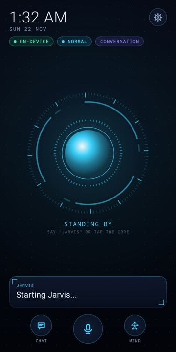
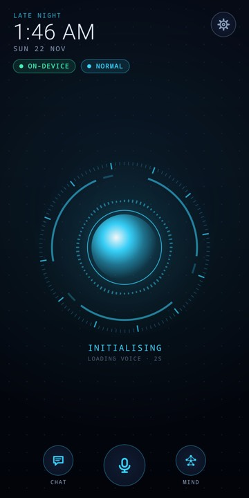

# Jarvis Edge

A voice assistant that lives entirely on an Android phone. It hears "Jarvis", understands you, thinks with a
small language model on the phone's CPU, speaks back, and learns from every conversation. It works with no
internet, and everything it hears and learns stays on the phone.

It was built for a 2018 Redmi Note 5 Pro (Snapdragon 636, 6 GB RAM, Android 9) that sits on a desk as an
always-on device, and also runs on a Realme Pad Mini (Helio G80, 4 GB).

<p>
  
  &nbsp;
  
</p>

**Android 9+ · arm64 · CPU only · Kotlin + Jetpack Compose · llama.cpp + sherpa-onnx · 318 unit tests**

## What it does

- **Wake word and speech.** A small keyword spotter waits for "Jarvis" and keeps the last 800 ms of audio so
  the first word isn't lost. A streaming recogniser follows you live, then Parakeet re-reads the whole clip
  (1.7% word errors on the test set). An arbiter picks the better transcript and applies corrections it has learned.
- **An on-phone brain.** Every request goes through the cheapest reliable path first: exact command patterns
  (time, timers, device), exact maths and unit conversion, personal facts you told it, and only then the language
  model. Answers that look like guesses trigger a web lookup or an honest "I'm not sure"; replies that echo you or
  claim an action that never happened are rejected.
- **A voice.** Local Piper text-to-speech voices, including Indian-accented English, with a voice picker and
  preview. Long sentences are spoken in pieces so memory stays low.
- **A crash-safe, self-learning mind.** Jarvis learns facts, vocabulary, corrections and shortcuts from its
  own conversations, reflects while idle, and can adapt the model overnight while charging, but only if an
  on-device eval approves it. Every save is crash-safe (atomic writes, write-ahead journal, saved model state),
  and every learned change is journaled and can be undone from the Mind screen or by voice.
- **Eyes and hands.** SmolVLM-256M describes what the camera sees; text recognition reads printed text; the IR
  blaster can switch a TV or AC.
- **A holographic HUD.** One shared theme around a reactor-style orb that reacts to your voice and shows
  thinking, web search and errors, with a calm mode for heat, low battery and night.

## Models

| Job | Model |
|---|---|
| Chat | Gemma 3 1B Q4_0 (default); Qwen2.5 1.5B / 0.5B Q4_0 (choose with `/sdcard/Jarvis/models/llm/active_model.txt`) |
| Wake word | sherpa-onnx Zipformer keyword spotter + Silero VAD |
| Speech to text | Parakeet TDT 110M (accurate), Kroko Zipformer (live), Moonshine tiny (fallback) |
| Text to speech | Piper voices (Alan, CMU Arctic, L2-Arctic, Kusal) |
| Vision | SmolVLM-256M-Instruct Q8_0 |
| Memory search | all-MiniLM-L6-v2 Q8_0 |

The phone's GPU is not used: on the Adreno 509 neither Vulkan, OpenCL nor NNAPI gives a working path, so all
speed work goes into the CPU. The APK carries one llama.cpp CPU backend per ARM feature level (NEON, dotprod,
fp16, int8 matmul, SVE2) and loads the fastest one the phone supports, and Jarvis tunes its thread counts per
phone while idle.

## How it's built

One Android app with one foreground service that owns the microphone and runs every step, from wake word to
spoken reply. Code is split by job under `app/src/main/java/com/jarvis/edge/`:

| Package | Job |
|---|---|
| `audio` | Microphone, wake word, speech segments, recognisers, transcript arbiter, voice out |
| `brain` | The reply pipeline: fast intents, maths, personal facts, the language model, confidence and claim guards |
| `mind` | Memory, reflection, the learning journal, crash recovery, overnight evolution and its eval gate |
| `core` | Turn loop, assistant states, chat and crash logs, atomic file writes, model paths, voices |
| `service` | The always-on service, watchdog, boot start, health guard (heat and memory), thread tuning |
| `tools` | Actions: time, timers, device state, web lookups, vision, infrared remote |
| `hud` | The screens: home HUD, chat, Mind, voice training, remote setup |

Native code (`app/src/main/cpp`) bridges to llama.cpp through JNI. Design notes are in
[`docs/superpowers/specs/`](docs/superpowers/specs/) and benchmark results in [`bench/results.md`](bench/results.md).

## Build and install

You need JDK 17, the Android SDK with NDK and CMake 3.22.1, and `adb`.

```bash
git clone --recurse-submodules https://github.com/amit-ate/Jarvis.git
cd Jarvis
scripts/setup-llama.sh          # llama.cpp v1.0.0 + Jarvis's patches (see patches/README.md)
scripts/fetch-models.sh         # downloads the models into models/ (several GB)
./gradlew assembleDebug         # builds app/build/outputs/apk/debug/app-debug.apk
./gradlew testDebugUnitTest     # unit tests, run on the computer
```

With the phone connected over USB (or wireless debugging):

```bash
scripts/device-prep.sh                       # frees the mic from "Hey Google", keeps the screen on while charging
scripts/push-models.sh google_gemma-3-1b-it-Q4_0.gguf
adb install -r app/build/outputs/apk/debug/app-debug.apk
```

Scripts pick the phone from `SERIAL` or `ANDROID_SERIAL`, or use the only one `adb` sees.

## Status

Working on the phones: voice in and out, the brain and its guards, the crash-safe mind, voice training, vision,
infrared and the redesigned HUD. In progress: downloading the models from inside the app, so a phone can be set up
without a computer.

## License

[MIT](LICENSE)
